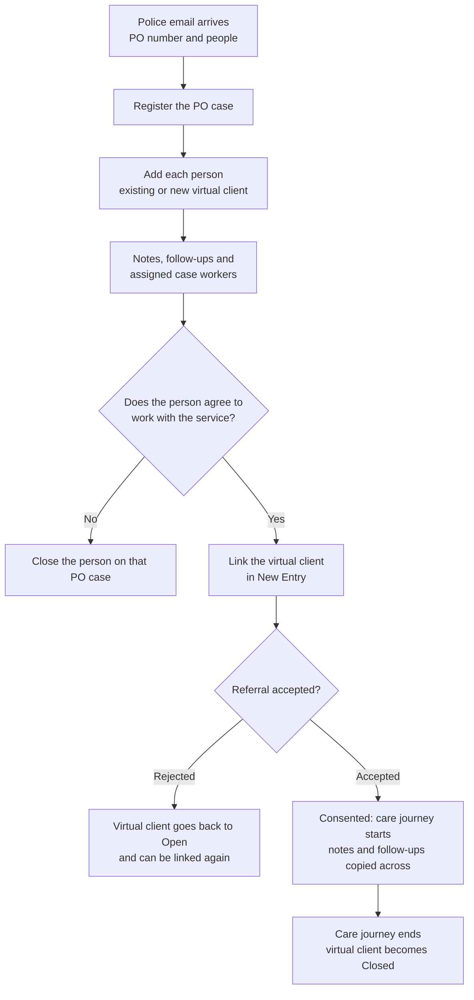

import Callout from '@site/src/components/Callout';

# What is a virtual client?

A virtual client is a placeholder for someone named in a Police referral, before
they agree to work with you.

By the end of this page you will know what a **virtual client** is, why it has no
name, and how it grows into a normal <Term path="serviceEpisode" /> when the person
agrees to work with your service.

Some services receive Police referrals about family-harm incidents. Each email has
a **PO number** (one incident) and a table of people. Before a person agrees to
work with the service, staff have no name for them in the system. A virtual client
is how the system still keeps track of them.

<Callout color="teal" title="Only available on some services">
Not every service uses virtual clients. If yours does not, you will not see
**Virtual Clients** in the left menu.
</Callout>

## What a virtual client is, and is not

A virtual client is a **placeholder** for one person named in a Police email.

| It holds | It never holds |
|----------|----------------|
| Date of birth (optional) | A name |
| Gender (optional) | |
| Address | |

**Why no name?** Names stay in the Police email. Staff find them by searching
their inbox for the PO number. The person only becomes a named record in the
system when they agree to work with the service and a
<Term path="referral" /> is made for them.

A virtual client is **not** a client record, a <Term path="referral" />, or a
<Term path="serviceEpisode" />. Nothing is delivered to a virtual client until it
becomes a care journey.

<Screen
  src="/img/manual/virtual-clients/overview/01-virtual-client-page.png"
  alt="A virtual client page showing a VC number, a Pre-consent badge, date of birth, gender and address, with one PO case listed and no name."
  caption="A virtual client before consent. It holds only date of birth, gender and address."
/>

## The pieces

| Piece | What it is |
|-------|------------|
| **PO case** | One incident, identified by its **PO number**. You copy the details from the Police email. The PO number is unique within a service. |
| **Person on a PO case** | One person from the Police table. Carries their **Police person number** (such as P1, V2 or MP3), their **Role on this case**, a status and the address given in that report. |
| **Virtual client** | The placeholder for the person, with a **VC number** such as VC-2026-ORG-00010. One virtual client can be on many PO cases. |
| **Assigned case workers** | The staff linked to a virtual client. Shown on its page under **Assigned case workers**. |
| **Notes and follow-ups** | Written on a PO case. A note can be tagged to several people at once. A follow-up is a reminder with a due date. |

Roles on a case are **Perpetrator**, **Victim**, **Mutual Participant** and
**Not stated**. The role belongs to the person on that PO case, not to the virtual
client. So the same person can be a victim in one incident and not stated in
another.

<Screen
  src="/img/manual/virtual-clients/overview/02-po-case-page.png"
  alt="A PO case page with a Case details card, a table of two people with Police numbers and roles, and a Notes section."
  caption="A PO case lists each person from the Police email, and each one points to a virtual client."
/>

## How it works from start to finish

1. A Police email arrives with a PO number and a table of people.
2. A staff member registers the **PO case** and adds each person. Each person is linked to an existing virtual client or given a new one.
3. Staff record notes and follow-ups, and assign case workers.
4. If the person agrees to work with the service, an intake officer or manager links the virtual client in **New Entry**.
5. A manager accepts the <Term path="referral" />. The virtual client is marked **Consented** and a <Term path="serviceEpisode" /> starts. Its notes and follow-ups are copied across.
6. When the <Term path="serviceEpisode" /> ends in the normal way, the virtual client becomes **Closed**.

If the person does not go on to work with the service, their involvement in each
PO case is closed instead (see [Closing and fixing](/manual/case-worker/virtual-clients-closing-and-fixing)).

<Callout color="amber" title="Nothing changes when the referral is only submitted">
The virtual client changes only when a manager **accepts** the
<Term path="referral" /> (or uses direct allocation). Submitting it does not
change the virtual client.
</Callout>

## Statuses

### Virtual client

| Status | Notes |
|--------|-------|
| **Open** | Not yet consented. A rejected <Term path="referral" /> also puts the virtual client back here. |
| **Closure requested** | Shown as a status. The source does not say exactly when the virtual client itself shows this. See [Known limits](#known-limits). |
| **In care journey** | Consented, and the <Term path="serviceEpisode" /> is running. |
| **Closed** | A never-consented virtual client closes when its last open PO case closes. A consented one closes when the care journey ends. |

Next to the status there is also a badge, **Pre-consent** or **Consented**.

### Person on a PO case

| Status | Meaning |
|--------|---------|
| **Open** | Work is being recorded on this case for this person. |
| **Closure requested** | A request to close them on this case is waiting for approval. |
| **In care journey** | The person's virtual client has consented and is in a care journey. |
| **Closed** | Their involvement in this PO case has ended. Approval of a closure is final. |

## One virtual client, many PO cases

The same person can appear in several Police emails. Each time, they are a new
person **on a new PO case**, but they should point to the **same** virtual client.
Their notes and follow-ups then sit together on one page.

**A person does the matching.** The system does not decide who is who. Staff
search by Police person number, address, date of birth or gender, then **check the
names in the Police email** to be sure. A search result is a suggestion, not a
decision.

Each person on a PO case keeps their own Police person number, role and address
for that incident. The address on one case does not change the address on another.

## Link, not merge

Virtual clients are **linked, never merged**. If a person was attached to the wrong
virtual client, use **Link to a different virtual client** on that PO case. It
moves that one person, on that one PO case, to the right virtual client.

- A reason is required, and it is kept in the history of both virtual clients.
- The Police number, role, status and address move with the person.
- That PO case's notes and follow-ups move with them. Assigned case workers do not.
- Until the person is in a care journey, you can relink them again to undo it. It is refused once the person is in a care journey, or once any of their notes have been copied to one.

There is no way to merge two virtual clients in one step. If one person was set up
twice, relink each PO case one at a time. See [Closing and fixing](/manual/case-worker/virtual-clients-closing-and-fixing).

## What carries over at consent

When a manager accepts the <Term path="referral" />:

| Carried over | Not carried over |
|--------------|------------------|
| The virtual client's notes, copied onto the care journey in date order. Each note keeps its PO number. | Assigned case workers (kaimahi). Assign staff to the care journey in the normal way. |
| Follow-ups, copied with their status kept. | |
| PO cases stay on the virtual client as links. | |

Also at consent:

- The virtual client is marked **Consented**, and a **Consented at** date is set.
- Any closure request still waiting for that person is closed automatically.
- Date of birth and gender can no longer be edited on the virtual client. Update the person's own record instead.
- After consent, new notes for that person are saved on the care journey, not on the PO case.

If the virtual client still shows **Pre-consent** after the referral was accepted,
tell your administrator. There is no button to retry.

## Who can do what

Seeing **Virtual Clients** depends on being **staff on a service that uses
virtual clients**, not on your role. Beyond that, some actions depend on your position.

| Action | Case worker | Intake officer | Supervisor or manager |
|--------|-------------|----------------|-----------------------|
| Register a PO case, add people, write notes | Yes, if staff on the service | Yes, if staff on the service | Yes |
| Edit a note | Only their own | Only their own | Any note |
| Delete a note | No | No | Yes |
| Delete a PO case (only when nobody is on it) | No | No | Yes |
| Link a virtual client in **New Entry** | No, as case workers cannot open New Entry | Yes | Yes |
| Accept the <Term path="referral" /> (consent) | No | Gap | Yes (manager) |
| Relink a person | Only if assigned to the person's current virtual client | Gap | Yes |
| Request closure by approval | Only if assigned to the person | Gap | Yes |
| Close directly | Only if their position is allowed | Only if their position is allowed | Usually yes |
| Withdraw a closure request | Only if they made it | Only if they made it | Yes |
| Approve or reject a closure | Only if their position is on the service's approver list | Only if their position is on the service's approver list | Usually yes |

Who may close directly or approve can differ from one service to another. The
usual answer is supervisor and manager. If it needs to change, ask your
administrator. A change can take up to 24 hours to apply.

**Gaps.** The source material does not say who can assign or remove case workers,
who can edit a PO case's details, who can edit a person's Police number, or
whether an intake officer can request closure or relink. Check these on your own
screen. New Entry access for virtual clients is also unverified for case workers.

## Which services use virtual clients

Only some services use virtual clients. If you think yours should, ask your
administrator. Two things can differ from one service to another or from one
organisation to another:

- **Who may close a person without approval.** Usually supervisors and managers.
- **The closure reasons** shown in the closing dialog. These belong to your organisation.

## Known limits

- **No merge.** Relinking moves one person on one PO case at a time.
- **No notifications.** Nobody is told when staff are assigned or removed, a person is relinked, or a closure is decided.
- **Closed, never-consented virtual clients** drop out of New Entry search.
- **Closing a consented person** does not prompt you to close a linked pre-consent person.
- **Joint notes** can appear as two rows in some lists, because each tagged person gets their own copy.
- **The list page status filter** has no **Closure requested** option.
- **A consented virtual client whose care journey has closed is never reopened.** If that person appears in a later Police email, a new virtual client is made.

## Where to go next

- [Registering a PO case and adding people](/manual/case-worker/virtual-clients-register-and-add-people)
- [Notes and follow-ups](/manual/case-worker/virtual-clients-notes-and-follow-ups)
- [Closing and fixing mistakes](/manual/case-worker/virtual-clients-closing-and-fixing)
- [Linking a virtual client to a referral](/manual/intake-officer/linking-a-virtual-client)
- [Closures and consent for supervisors](/manual/supervisor/virtual-clients-closures-and-consent)
- [How the work flows](/how-the-work-flows)
- [Glossary](/glossary)

<Screen
  src="/img/manual/virtual-clients/overview/03-virtual-clients-list.png"
  alt="The Virtual Clients list with two tabs, a search box and a table of virtual clients with VC numbers, PO case counts and statuses."
  caption="The Virtual Clients list. This is where you start."
/>

## If your screen does not match this page

- No **Virtual Clients** menu: your service does not use virtual clients, or you are not staff on it. Ask your administrator.
- A button or menu item is missing: it depends on your position. Ask a supervisor or manager.
- Something looks different from what is described here: tell your supervisor and your administrator, and say which page you were on.
